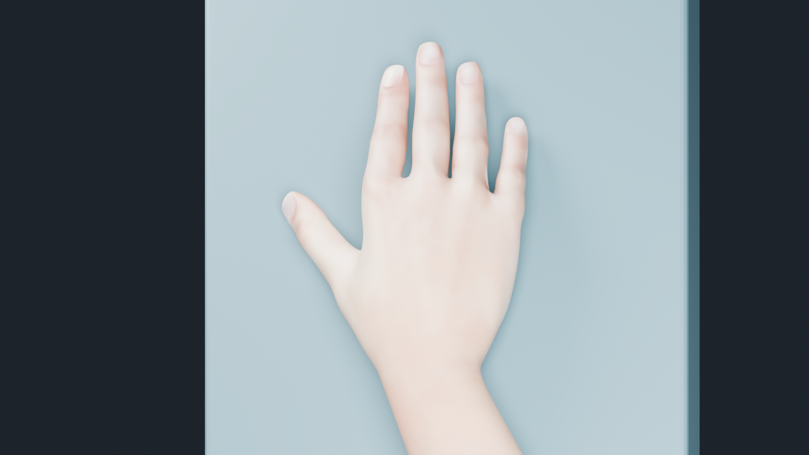

# Hand Posing

Fit a Rigify hand to a nearby mesh surface. The addon adjusts the hand IK control,
palm, and finger controls. The resulting pose stays editable. Auto Keying records
the controls when enabled.



The preview shows an adult female MPFB model's hand after snapping to a surface
and refining the thumb with the editable rig controls.
The model uses MPFB's CC0 core assets; see [preview provenance](docs/preview-provenance.json).
Skin and nail appearance use MakeHuman's female diffuse texture and MPFB's
fingernail roughness mask.

Requires Blender 5.2 or later and standard Rigify hand controls with `.L` and `.R`
names. Target surfaces should be locally convex. Source code uses GPL-3.0-or-later;
see [LICENSE](LICENSE).

## Install

1. Download or build `hand_posing-0.1.1.zip`.
2. In Blender, open **Edit > Preferences > Get Extensions**.
3. Open the menu in the upper right and choose **Install from Disk**.
4. Select the ZIP and enable **Hand Posing**.

The extension includes its solver and uses Blender's own Python modules.
Installation supports offline use on Windows, macOS, and Linux.

## Use

1. Select a Rigify hand IK or finger control in Pose Mode.
2. Open **Item > Hand Posing** in the 3D Viewport sidebar.
3. For a new hand, choose **Hand skin** and click
   **Calibrate Hand**. Use a mesh with weighted palm and finger geometry.
4. Place and rotate the hand IK near the intended contact.
5. Choose **Surface** and click **Snap Hand**, or use **F3 > Snap Hand**.
6. Refine the pose with the rig controls and insert keys. Use Blender's Undo to
   restore a prior pose.

Calibrate each hand once and save the Blender file. Existing `Snap Hand
Calibration` data works directly. Calibrating again replaces that hand's stored
contact measurements. Capture after changes to hand proportions or skin geometry.

Palm contact and finger fitting follow the evaluated surface. Own-body targets
use the body beyond the moving arm. The native wrist constraints remain active.
When contact lies beyond the arm's reach, adjust the arm or target spacing and
snap again. The solver is intended for nearby contact, with meter-sized character
geometry: its contact tolerances use Blender units as meters. Scale the rig and
mesh data to a human scale before calibration.

New calibrations use measured skin support for placement. Existing calibrations
that use a hand control rectangle retain their rectangle fitting workflow.
The native rig's reach and joint ranges determine achievable contact. Finger
tips and pads approach the surface where their joint ranges permit it; curved
or spread fingers can retain a visible gap at some joints.

Meshes use standard `DEF-hand`, `DEF-palm`, and `DEF-` finger vertex groups.
The arm includes `hand_ik`, `DEF-hand`, `upper_arm_parent` with `IK_FK`, and three
controls per finger. Custom rig layouts need a matching adapter. The public setup
captures contact samples from evaluated rest skin and restores the current pose.
An anatomical rest hand supplies the calibration reference. Native limits and a visual review guide
the final pose. Dense skin and target geometry increase solve time.

## Scripting

An installed Blender extension receives a repository namespace. Resolve its
module through the enabled addons:

```python
import importlib
import bpy

name = next(name for name in bpy.context.preferences.addons.keys()
            if name.rsplit('.', 1)[-1] == 'hand_posing')
addon = importlib.import_module(name)
rig = bpy.context.object
solver = addon.retrieve_snap_solver(bpy.context, rig, 'R')
solver.snap(bpy.data.objects['Contact surface'], keyframe=True)
```

`addon.HandCalibration(context, rig, side, skin).capture()` captures a hand.
`addon.HandSnap` retains the calibrated base placement API.
`addon.HandSurface` snapshots evaluated geometry for scripted contact queries.
These entry points require Blender's Python runtime.

## Build and verify

With Python 3.11 or later and Blender 5.2 available:

```sh
python tools/check.py --blender /path/to/blender
python tools/build.py --blender /path/to/blender
```

The check command creates a temporary Blender profile, validates and builds the
extension, installs the ZIP, reopens Blender, exercises generated hands, and
disables and enables the extension. It compares the regular preferences file
before and after. `dist/` receives the validated ZIP and a SHA-256 checksum.
It also checks the ZIP's exact runtime file list and exercises Blender's reload
routine twice, followed by the hand workflows with the refreshed modules.
The suite includes calibration and snapping on a freshly generated Rigify
character, plus synthetic hand fixtures for operator and saved-file workflows.

Run solver checks directly in an isolated Blender profile:

```sh
blender --background --factory-startup --python-exit-code 1 --python hand_posing/test_hand_posing.py
```

The game consumes a pinned snapshot of this package. Develop the solver here,
then use the game's `scripts/blender/sync_hand_posing.py --source PATH` to
refresh that dependency and its checksum record.

See [CONTRIBUTING.md](CONTRIBUTING.md) for changes and
[docs/publishing.md](docs/publishing.md) for public listings.
